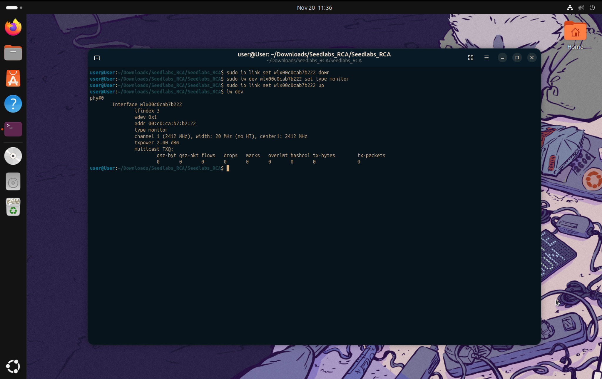
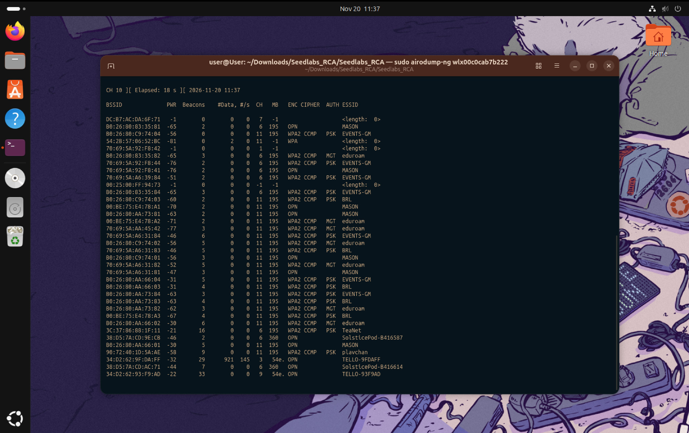
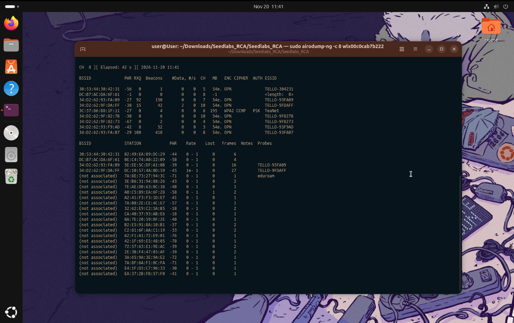
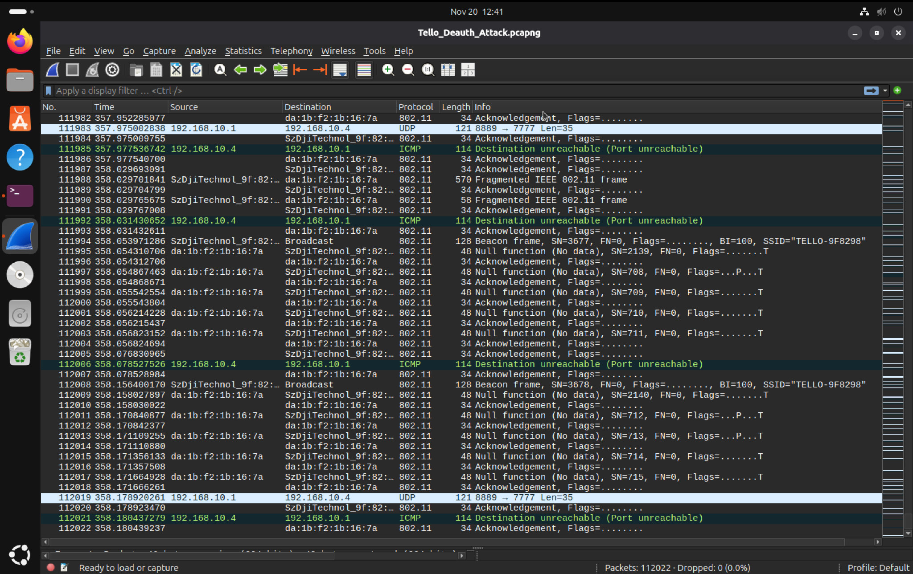

# CYSE 425 — Lab 6: Drone Disruption Lab

**Student:** Harshith Motipalli  
**Course:** CYSE 425 — Wireless Security  
**Tools:** Ubuntu VM, USB Wi-Fi adapter, Aircrack-ng, Wireshark, DJI Tello

## Summary
This lab investigates 802.11 Wi-Fi communication and possible connection disruption between a DJI Tello drone and a mobile controller. Evidence covers monitor-mode setup, wireless discovery, a channel-specific scan, and network-packet review.

## At a glance
| Item | Evidence |
| --- | --- |
| Linux interface | wlx00c0cab7b222 |
| Wireless adapter | Monitor mode confirmed using iw dev |
| Tello network seen | TELLO-93FA07 |
| Tello BSSID | 34:d2:62:93:fa:07 |
| Channel-specific discovery | Channel 8 |
| PCAPNG capture | Tello_Deauth_Attack.pcapng, 31,688,896 bytes, separately included in the downloadable ZIP |
| Captured packet records | 112,022 |
| Deauthentication frames | 80 |

## Assessment workflow and evidence

### Task 1 — Configure monitor mode
The external wireless interface was brought down, configured for 802.11 monitor mode, and brought back up. The iw dev output verifies the interface type.

### Task 2 — Discover wireless networks
Airodump-ng scanned local 802.11 access points, revealing BSSIDs, channels, signal information and wireless security configurations.

### Task 3 — Inspect the selected channel
The scan was restricted to channel 8. Multiple Tello access points appeared, including TELLO-93FA07 with BSSID 34:d2:62:93:fa:07.

### Task 4 — Review capture in Wireshark
The supplied screenshot shows the Tello_Deauth_Attack.pcapng recording containing 802.11 traffic, UDP exchanges and ICMP destination-unreachable messages.

## Results and limits
The original packet capture was inspected: 112,022 packet records were found, along with 80 decodable 802.11 deauthentication frames. Those frames were associated with four BSSIDs: 34:d2:62:9f:82:98 (71 frames), 34:d2:62:94:0c:77 (3), 38:d5:7a:cd:9e:cb (3), and 38:d5:7a:cd:ac:71 (3).

**Important:** None of these deauthentication frames had the previously identified 34:d2:62:93:fa:07 BSSID. The evidence therefore does not conclusively establish deauthentication of TELLO-93FA07, even though it documents wireless traffic and disruption-related observations. The worksheet also requests controller-switching and regain-control testing, which the four screenshots do not conclusively verify.

To examine the capture in Wireshark, use the display filter wlan.fc.type_subtype == 0x0c for deauthentication frames; use wlan.bssid == 34:d2:62:93:fa:07 to view frames with the identified target BSSID.

## Lab worksheet
The instructor's original printed lab instructions are available at [Lab instructions](docs/lab-instructions.jpg). These outline monitor-mode configuration, drone connection and wireless capture, disruption observation, and two-controller reconnection testing.

## Files
- assets/screenshots/: numbered evidence images embedded above
- docs/lab-instructions.jpg: photograph of the supplied worksheet
- captures/README.md: notes on the supplied capture

The 31 MB original PCAPNG was provided by the student but could not be transferred to GitHub through the connected binary-upload workflow. It is included in the downloadable ZIP package accompanying this repository, and may be copied into captures/ locally. Do not treat this README link as a hosted packet capture.

## Demonstrates
Linux networking, wireless monitoring, 802.11 BSSID and channel interpretation, Aircrack-ng discovery, Wireshark packet analysis, and evidence-based security reporting.

**Scope:** Only perform disruptive wireless experiments in an explicitly authorized, controlled environment.
